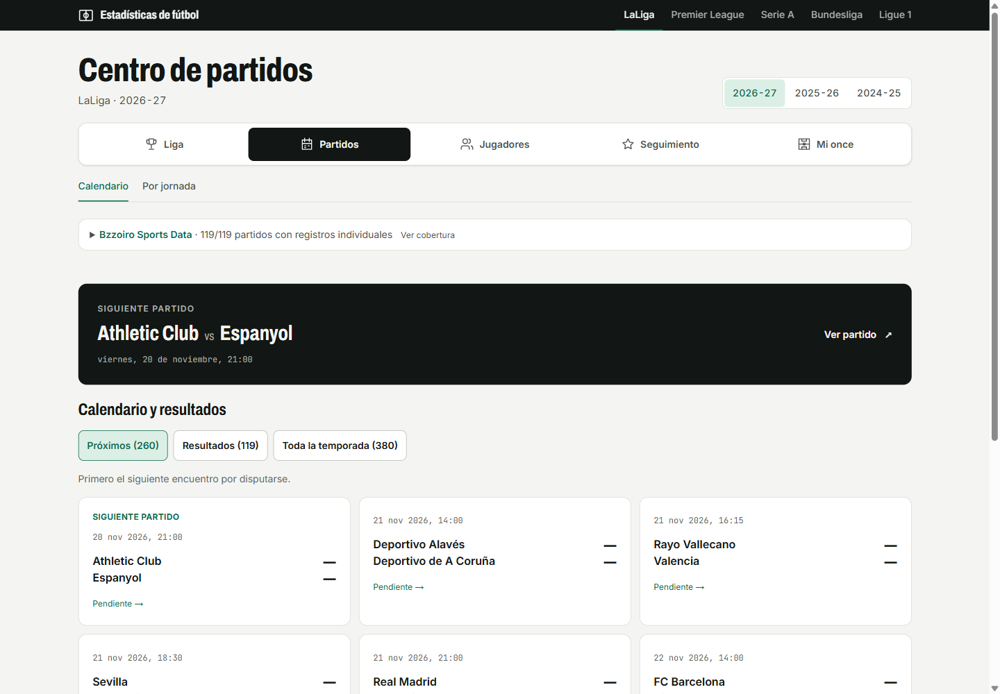

# Dashboard de fútbol: detalles técnicos

Este documento explica cómo cargar los datos, cómo está organizado el código y qué
limitaciones tienen los datos. La presentación general, con capturas, está en el
[README principal](../README.md).

El proyecto descarga partidos reales de una API pública de fútbol, los completa con
estadísticas por partido de una segunda fuente, lo guarda todo en PostgreSQL, lo limpia con
pandas y lo muestra en una web hecha con Next.js (`web/`).



La base de datos contiene:

- Cinco ligas: LaLiga (PD), Premier League (PL), Serie A (SA), Bundesliga (BL1) y
  Ligue 1 (FL1).
- Partidos con los goles al descanso.
- Fichas de equipo y plantillas por temporada (`squad_members`).
- Goleadores por temporada.
- Estadísticas por partido: xG, tiros, córners, faltas y tarjetas.

## Ampliación individual y navegación

La web separa **Liga**, **Partidos**, **Jugadores**, **Seguimiento** y **Mi once**. Bzzoiro Sports Data aporta actuaciones individuales, alineaciones, eventos y tiros en tablas `bsd_*`. Las vistas consultan PostgreSQL, sin peticiones externas al navegar. La importación de 2026-27, las correspondencias entre equipos, los cálculos por 90 y los límites conocidos están en la [guía de integración](../docs/bsd-integration.md).

```powershell
# Después de cargar los datos base y configurar BZZOIRO_API_KEY en .env
.venv/Scripts/python.exe -m sports_dashboard.bsd --competitions PD PL SA BL1 FL1 --season 2026
.venv/Scripts/python.exe -m sports_dashboard.bsd --mapping-file data/bsd_team_map.json
```

## Arquitectura

```
football-data.org  ->  client  ->  transform (pandas)  ->  ingest  ->  PostgreSQL
                                                                           ^   |
football-data.co.uk (archivos CSV)  ->  stats_import  ------------------+   |
                                                                            v
                                                              Web Next.js (web/)
```

| Módulo | Qué hace |
|---|---|
| `client.py` | Cliente HTTP que espacia las peticiones y reintenta cuando la API responde 429 |
| `transform.py` | Funciones puras que limpian los datos de la API y los convierten en tablas |
| `ingest.py` | Guarda partidos, equipos, plantillas y goleadores en PostgreSQL sin duplicar filas aunque se ejecute dos veces (upsert idempotente) |
| `stats_import.py` | Importa las estadísticas por partido de los CSV de football-data.co.uk |
| `queries.py` | Consultas SQL de apoyo en Python: clasificación, forma, resultados y temporadas (la web tiene sus propias consultas en `web/`) |

La clasificación se calcula con SQL a partir de los partidos terminados (victoria 3 puntos,
empate 1); los partidos decididos en los despachos cuentan con el resultado oficial. Los
empates a puntos se deshacen por diferencia de goles y después por goles a favor, no con las
reglas oficiales de enfrentamiento directo, así que dos equipos empatados pueden salir en
otro orden que en la tabla oficial.

## Arrancarlo en local

Necesitas Python 3.12+, Docker y una clave gratuita de
[football-data.org](https://www.football-data.org/client/register).

```bash
cd 01-dashboard-deportes
python -m venv .venv
.venv\Scripts\activate          # Linux/macOS: source .venv/bin/activate
pip install -r requirements.txt
pip install -e .                # permite importar `sports_dashboard`

cp .env.example .env            # pon tu clave en FOOTBALL_API_KEY
docker compose up -d            # PostgreSQL en localhost:5433

python -m sports_dashboard.ingest --competitions PD --seasons 2024
```

PostgreSQL se publica en el puerto **5433** del ordenador para no chocar con una instalación
local de PostgreSQL que use el puerto por defecto, 5432.

## Web (Next.js)

Funciona en local; no hay despliegue público.

`web/` contiene una web en español (diseño claro) que lee la misma base de datos
directamente con componentes de servidor. Para cada liga y temporada de la base muestra la
clasificación (tarjetas de resumen, forma, barra de puntos y zonas), los resultados por
jornada, los goleadores, una ficha de equipo (datos del club, balance en casa y fuera,
gráfico de evolución de puntos por temporada, estadísticas por partido como xG y tiros,
plantilla de la temporada y partidos) y un comparador de dos equipos con sus enfrentamientos
directos. Los gráficos son SVG generados en el servidor, con una tabla como alternativa.

```bash
cd web
cp .env.example .env.local      # solo DATABASE_URL; nunca se sube a git
npm install
npm run dev                     # http://localhost:3000
```

Rutas: `/{liga}/{año}` (clasificación), `/{liga}/{año}/resultados/{jornada}`,
`/{liga}/{año}/goleadores`, `/{liga}/{año}/equipo/{id}` y
`/{liga}/{año}/comparar?a={id}&b={id}`. Ligas: `pd`, `pl`, `sa`, `bl1`, `fl1`. Los scripts
y los tests están en [`web/README.md`](web/README.md). La web nunca llama a la API.

## Cargar datos

### Partidos, equipos, plantillas y goleadores (football-data.org)

```bash
# varias ligas y temporadas de una vez
python -m sports_dashboard.ingest --competitions PD,PL,SA,BL1,FL1 --seasons 2024,2025,2026

# solo algunos pasos
python -m sports_dashboard.ingest --competitions PD --seasons 2024 --what matches,scorers
```

| Opción | Significado |
|---|---|
| `--competitions` | Códigos de competición separados por comas. Por defecto `PD`. El plan gratuito incluye `PD`, `PL`, `SA`, `BL1` y `FL1`. |
| `--seasons` | Años de inicio de temporada separados por comas, por ejemplo `2024,2025`. Obligatoria. |
| `--what` | Pasos separados por comas: `matches`, `teams`, `scorers`. Por defecto, los tres. |

### Estadísticas por partido (football-data.co.uk)

football-data.org no da estadísticas por partido, así que el xG, los tiros, los córners, las
faltas y las tarjetas vienen de los CSV que publica
[football-data.co.uk](https://www.football-data.co.uk/). Cada usuario los descarga a mano y
nunca se suben al repositorio (`data/external/` está ignorado por git).

1. Descarga un archivo por división y temporada desde
   `https://www.football-data.co.uk/mmz4281/<aaAA>/<DIV>.csv`, por ejemplo
   `https://www.football-data.co.uk/mmz4281/2627/SP1.csv`. `<aaAA>` es la temporada escrita
   con los dos últimos dígitos del año de inicio y del de fin (`2627` es 2026-27).
2. Guarda cada archivo como `data/external/football-data-co-uk/<aaAA>/<DIV>.csv`.
3. Ejecuta la importación:

```bash
python -m sports_dashboard.stats_import
```

Las divisiones corresponden a estas competiciones: `SP1` -> `PD`, `E0` -> `PL`,
`I1` -> `SA`, `D1` -> `BL1` y `F1` -> `FL1`. Opciones: `--folder` (por defecto
`data/external/football-data-co-uk`) y `--aliases` (por defecto `data/team_aliases.csv`).

Ejecuta antes la ingesta de football-data.org: la importación busca cada fila del CSV entre
los partidos que ya están en la base.

La importación escribe una línea por archivo (`matched`, `unmatched`). Debajo, por stderr,
lista cada pareja sin emparejar como `  Local - Visitante`: una fila del CSV sin partido en
la base, o la señal de un alias equivocado (que apunta al equipo que no es). Las filas sin
emparejar no hacen fallar la ejecución. Código de salida 0: todo bien; 1: hay nombres de
equipo que no reconoce o un problema en el archivo de alias.

**Alias de nombres de equipo.** Las dos fuentes escriben algunos nombres de forma distinta.
La importación lista todos los nombres que no reconoce y no importa nada hasta que
`data/team_aliases.csv` los cubra. El archivo tiene dos columnas, `alias,team_id`: `alias`
es el nombre tal como aparece en el CSV (se ignoran mayúsculas, tildes y signos) y `team_id`
es el id de ese equipo en la tabla `teams`. Añade una línea por cada nombre no reconocido y
vuelve a ejecutar la importación. El archivo se valida antes de importar nada: las celdas
vacías y los `team_id` que no son un número o no existen en `teams` se informan juntos, con
su número de línea.

```
alias,team_id
Ath Madrid,78
```

**Condiciones de uso.** football-data.co.uk indica que sus datos son para particulares, no
para uso comercial ni para entrenar IA. Lee sus condiciones antes de reutilizar los archivos.

## Tests

```bash
pytest -q
```

Los tests usan una base de datos aparte, `sports_test`, del mismo contenedor de Docker, un
cliente de API falso y un reloj simulado, así que nunca llaman a la API real ni esperan por
los límites de peticiones. GitHub Actions los ejecuta en cada cambio.

## Fuentes de datos y límites

- [football-data.org](https://www.football-data.org/), plan gratuito: partidos, equipos,
  plantillas y goleadores. Revisa sus condiciones antes de reutilizar los datos.
- [football-data.co.uk](https://www.football-data.co.uk/): estadísticas por partido, a partir
  de CSV que descargas tú (ver arriba).

El plan gratuito de football-data.org permite unas 10 peticiones por minuto, así que cargar
5 ligas x 3 temporadas tarda unos 5 minutos. Una competición que no entra en tu plan se
informa como fallo y se salta, y el resto de la carga continúa.

## Limitaciones de los datos

- Las plantillas son por temporada y están en `squad_members(season, team_id, player_id)`.
  Volver a cargar una temporada sustituye la plantilla de ese equipo en esa temporada.
- `players` tiene una fila por persona. Su `team_id` es el equipo de la última temporada
  cargada, así que conviene cargar las temporadas de una vez (por ejemplo
  `--seasons 2024,2025,2026`): se procesa primero la más antigua y gana la más reciente.
- El entrenador de `teams.coach` es siempre el actual, sea cual sea la temporada cargada.
- La lista de goleadores no trae la posición, así que la posición de cada jugador sale de las
  plantillas.

## CI

GitHub Actions ejecuta dos trabajos en cada cambio, cada uno con su propio PostgreSQL:

- `python`: pytest para el código de ingesta.
- `web`: ESLint, comprobación de tipos de TypeScript, tests de Vitest y `next build`.

## Próximos pasos

- Fase B: estadísticas de jugadores con API-Football.
- Fase D: análisis histórico con los datos abiertos de StatsBomb.
- Predicción de resultados con scikit-learn, comparada con la regla "gana el de casa".
