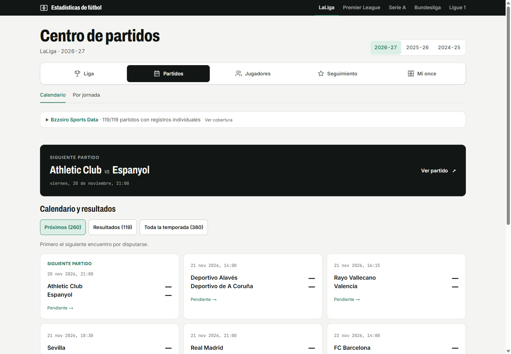
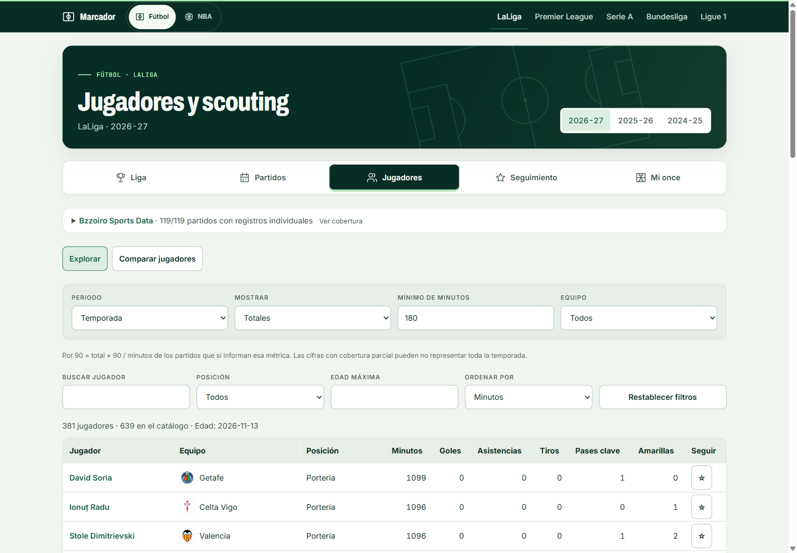
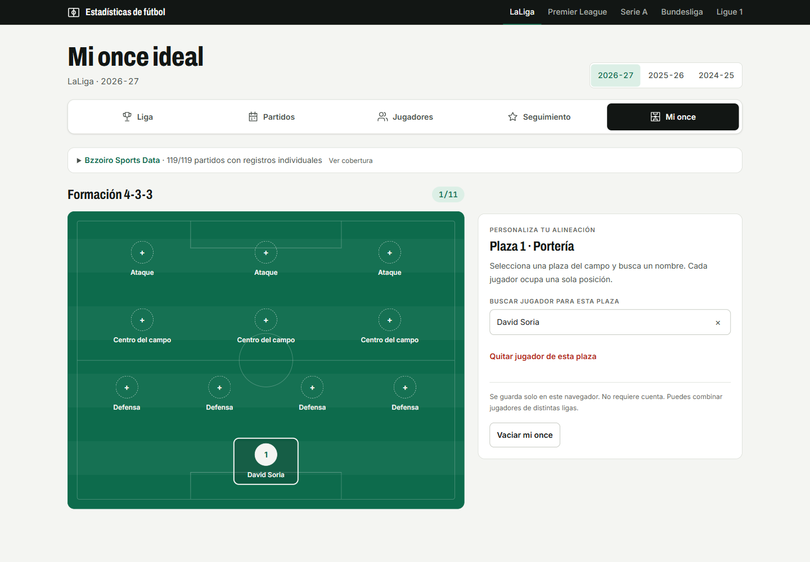
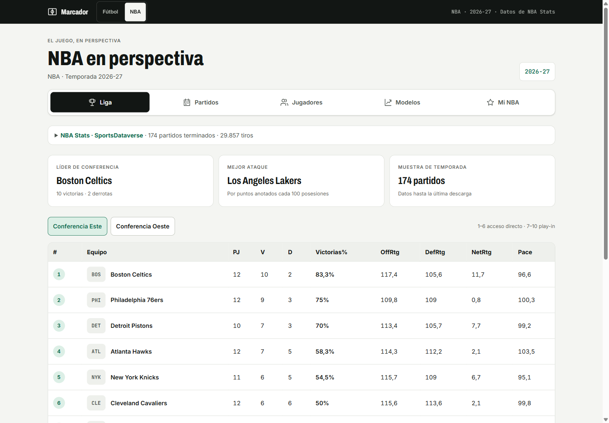
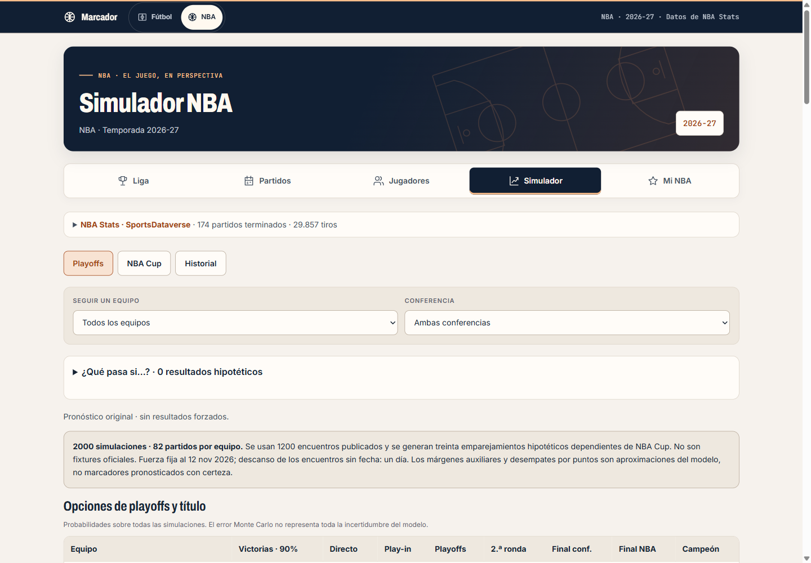
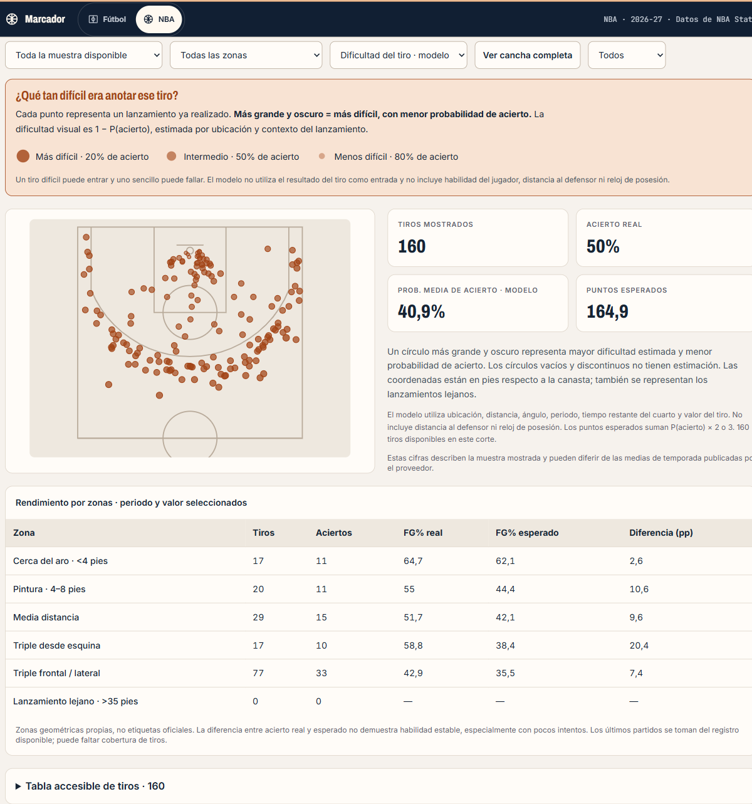
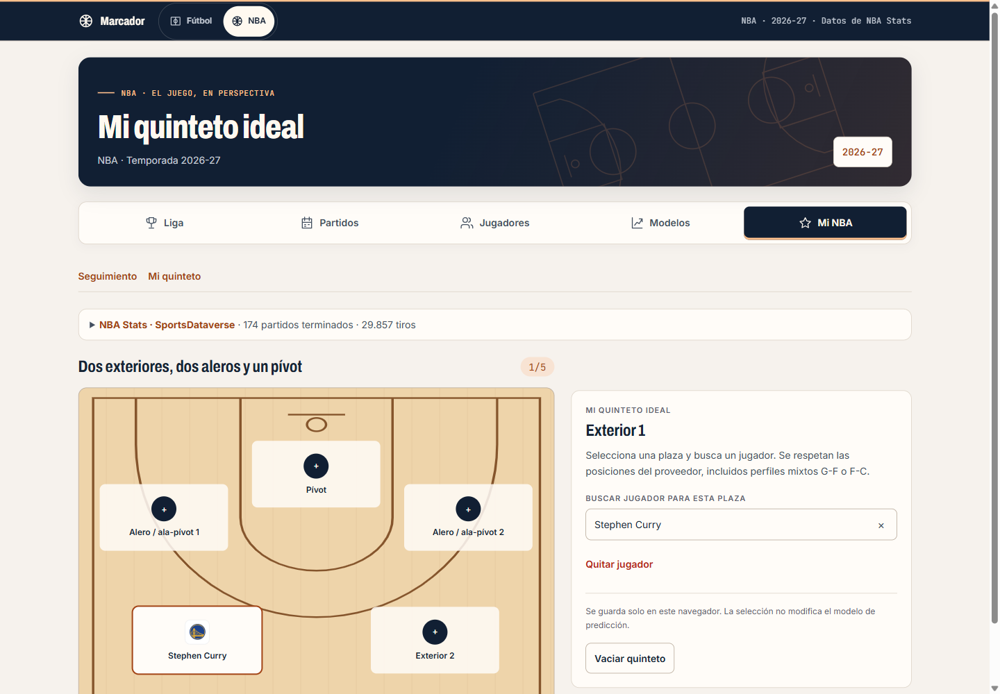
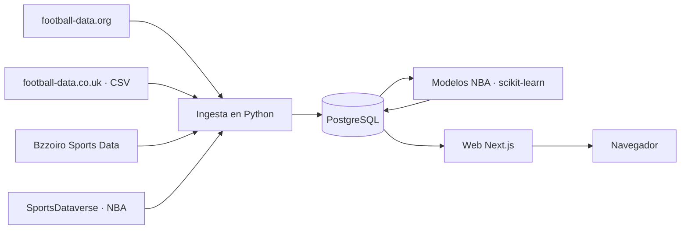

# Marcador · fútbol y NBA con datos reales

[](https://github.com/liamanderson873/Dashboard-Deportes/actions/workflows/ci.yml)

**Marcador** es una aplicación web en español con estadísticas de las cinco grandes ligas europeas de fútbol y de la NBA. Descarga datos reales con **Python**, los guarda en **PostgreSQL** y los muestra con **Next.js**. Para la NBA incluye además modelos que estiman quién ganará cada partido y simulan la temporada.

**[Abrir la demo pública](https://marcador-xi.vercel.app)** · [ver el recorrido en vídeo (90 s)](docs/media/marcador-90s.mp4) · [guía explicada paso a paso](docs/guia-explicada.md)



## Contenido

- [Qué puedes hacer](#qué-puedes-hacer)
- [Cómo funciona](#cómo-funciona)
- [Los modelos de la NBA](#los-modelos-de-la-nba)
- [De dónde salen los datos](#de-dónde-salen-los-datos)
- [Comprobar que todo funciona](#comprobar-que-todo-funciona)
- [Cómo está organizado el repositorio](#cómo-está-organizado-el-repositorio)
- [Documentación](#documentación)
- [Límites conocidos](#límites-conocidos)

## Qué puedes hacer

Un selector **Fútbol / NBA** separa los dos deportes. Cada uno tiene su propio color: verde estadio para el fútbol y azul noche con cobre para la NBA.

### Fútbol

LaLiga, Premier League, Serie A, Bundesliga y Ligue 1, temporada 2026-27. La clasificación y las fichas de equipo también admiten temporadas anteriores.

| Sección | Qué muestra |
|---|---|
| **Liga** | Clasificación con forma reciente, goleadores, fichas de equipo y comparador de dos equipos con sus enfrentamientos directos. |
| **Partidos** | El próximo encuentro, resultados recientes y la temporada por jornadas. Cada partido tiene alineaciones, eventos, estadísticas y mapa de tiros cuando el proveedor los ofrece. |
| **Jugadores** | Buscador con filtros por equipo, posición, edad y minutos. Fichas con evolución, percentiles y jugadores parecidos. Comparación de dos jugadores, en totales o por 90 minutos. |
| **Seguimiento** | Tus equipos y jugadores favoritos, y sus próximos partidos. |
| **Mi once** | Un 4-3-3 sobre un campo, con búsqueda por nombre y una plaza por posición. |

| Jugadores | Mi once |
|---|---|
|  |  |

### NBA

Clasificación por conferencias, ratings avanzados, partidos con box score, fichas de equipos y jugadores, un mapa para cruzar dos estadísticas de jugadores, seguimiento y tu quinteto ideal. Además:

- **Laboratorio de playoffs:** simula 2.000 veces el resto de la temporada, la NBA Cup, el play-in y los playoffs. Puedes fijar el ganador de algunos partidos y ver cómo cambian las probabilidades.
- **Calidad del tiro:** mapa de aciertos y fallos con la probabilidad estimada de cada lanzamiento.

| Clasificación NBA | Simulador de playoffs |
|---|---|
|  |  |
| **Calidad del tiro** | **Mi quinteto** |
|  |  |

Los favoritos, «Mi once» y el quinteto se guardan en tu navegador: no hay registro ni cuentas. La web se adapta al móvil, se puede usar con teclado y ofrece tablas como alternativa a los gráficos.

## Cómo funciona



1. **Ingesta (Python).** Unos programas descargan los datos de cada fuente, los limpian con pandas y los guardan en PostgreSQL. Se pueden ejecutar varias veces sin duplicar nada (son *idempotentes*). Solo esta parte habla con internet.
2. **Base de datos (PostgreSQL).** Guarda equipos, partidos, jugadores, tiros, modelos y predicciones. En local se levanta con Docker.
3. **Modelos (Python, solo NBA).** Se entrenan en tu ordenador con datos históricos y sus resultados se guardan en la base de datos. La web nunca entrena nada.
4. **Web (Next.js).** Las páginas leen PostgreSQL directamente desde el servidor (*componentes de servidor*) y envían al navegador la página ya montada. Navegar por la web no gasta peticiones de las API deportivas.

| Parte | Tecnologías |
|---|---|
| Datos y modelos | Python 3.12+, pandas, requests, SQLAlchemy, scikit-learn |
| Base de datos | PostgreSQL 16 en Docker |
| Web | Next.js 16, React 19, TypeScript, Tailwind CSS 4 |
| Calidad | pytest, Ruff, Vitest, ESLint y GitHub Actions |
| Demo pública | Vercel (web) y Neon (copia de la base de datos, solo lectura) |

## Los modelos de la NBA

- **Ganador de cada partido:** regresión logística entrenada con diez temporadas completas. Usa la diferencia entre los dos equipos en ataque, defensa, ritmo, tiro, rebote, pérdidas, descanso y factor cancha.
- **Probabilidad de acierto de cada tiro:** gradient boosting entrenado con tres temporadas. Usa la posición en la pista, la distancia, el ángulo, el periodo, el reloj y el valor del tiro.
- **Simulación de la temporada:** Monte Carlo. Se juegan miles de veces los partidos que faltan con las probabilidades del modelo y se cuenta cuántas veces cada equipo llega a playoffs o gana el título.

**Cómo se comprueba que funcionan.** Cada estadística se calcula solo con partidos anteriores al que se predice, así que el modelo no ve el futuro. La nota final se pone con una temporada entera (2025-26) que el modelo no vio al entrenar, y se compara con métodos de referencia más sencillos:

| Qué predice | Modelo de Marcador | Referencia | AUC (más alto es mejor) | Brier (más bajo es mejor) |
|---|---|---|---|---|
| Ganador del partido | Regresión logística | Elo | **0,736** frente a 0,711 | **0,207** frente a 0,215 |
| Acierto del tiro | Gradient boosting | Regresión logística | **0,651** frente a 0,643 | **0,229** frente a 0,234 |

Un AUC de 0,5 equivale a lanzar una moneda, y no es lo mismo que el porcentaje de aciertos. Los resultados completos, con gráficos de calibración, están en [docs/nba/evaluacion-2026.json](docs/nba/evaluacion-2026.json). La metodología se explica en [docs/nba/metodologia.md](docs/nba/metodologia.md).

## De dónde salen los datos

| Fuente | Qué aporta |
|---|---|
| [football-data.org](https://www.football-data.org/) | Equipos, calendario, resultados, plantillas y goleadores. Necesita una clave gratuita. |
| [football-data.co.uk](https://www.football-data.co.uk/) | Estadísticas de partido (xG, tiros, córners, faltas, tarjetas) en CSV. |
| [Bzzoiro Sports Data](https://sports.bzzoiro.com/) | Jugadores, actuaciones, alineaciones, eventos y tiros. Necesita una clave gratuita. |
| [SportsDataverse / NBA Stats](https://github.com/sportsdataverse/hoopR-nba-stats-data) | Partidos, jugadores y tiros de la NBA, en archivos públicos con licencia CC BY 4.0. |

- Las claves se configuran solo en Python. No hay claves ni datos externos en el repositorio.
- Los datos no se actualizan solos: para refrescarlos hay que volver a ejecutar la ingesta.
- Si falta un dato se muestra **—**, nunca un cero inventado. Las cifras por 90 minutos solo cuentan los partidos que informan esa estadística.
- Muestra actual de la NBA 2026-27: 30 equipos, 528 jugadores, 174 partidos terminados y 29.857 tiros. Muestra de fútbol (importación de Bzzoiro del 13 de noviembre de 2026): 1.752 partidos y 3.031 jugadores en las cinco ligas.

## Comprobar que todo funciona

```powershell
# Desde 01-dashboard-deportes
.venv/Scripts/python.exe -m ruff check .
.venv/Scripts/python.exe -m pytest -q
# Desde 01-dashboard-deportes/web
npm run lint
npm run typecheck
npm test
npm run build
```

Hay **137 tests de Python y 211 de la web**. Los tests de integración usan una base de datos aparte, `sports_test`, para no tocar tus datos; no ejecutes las dos suites a la vez contra ella. GitHub Actions ejecuta todo esto en cada cambio, cada parte con su propia base de datos.

## Cómo está organizado el repositorio

```text
README.md                    Esta página
.github/workflows/ci.yml     Pruebas automáticas en cada cambio
docs/                        Documentación (ver la tabla siguiente)
01-dashboard-deportes/
  src/sports_dashboard/      Ingesta en Python (fútbol)
    nba/                     Ingesta, entrenamiento y simulación de la NBA
  sql/                       Esquema de la base de datos (schema.sql, nba.sql)
  tests/                     Tests de Python y datos de ejemplo
  scripts/                   Copia de la base para la demo y GIF de demostración
  data/                      Correspondencias de equipos entre proveedores
  docs/img/                  Capturas que usa este README
  docker-compose.yml         PostgreSQL en local
  web/                       Aplicación Next.js
    src/app/                 Páginas: una carpeta por ruta (/pd/2026, /nba/2026...)
    src/components/          Piezas de la interfaz y gráficos
    src/lib/                 Consultas a la base de datos y cálculos
```

## Orientarse en la web

El botón **Explorar**, disponible en la cabecera de ambos deportes, reúne las herramientas de la liga y temporada actuales y permite buscarlas por nombre. Las migas de pan muestran la ruta de las páginas; las fichas añaden un índice de secciones y enlaces al equipo, al comparador y a otras vistas relacionadas. El panel usa [UI SDK de Vercel](https://github.com/vercel-labs/ui) para gestionar teclado, foco y cierre con Escape.

## Documentación

| Documento | Para qué sirve |
|---|---|
| [Guía explicada](docs/guia-explicada.md) | Recorrido por el proyecto para quien empieza: qué hace cada parte y por qué. |
| [Ingesta de fútbol](01-dashboard-deportes/README.md) | Cómo se cargan los datos, los módulos de Python y el cálculo de la clasificación. |
| [Datos de jugadores](docs/futbol/datos-de-jugadores.md) | Integración de Bzzoiro: configuración, fórmulas por 90 y límites. |
| [Web](01-dashboard-deportes/web/README.md) | Rutas, desarrollo y estructura de la aplicación Next.js. |
| [NBA: metodología](docs/nba/metodologia.md) | Fuentes, variables, entrenamiento, evaluación y cómo reproducirlo. |
| [NBA: laboratorio](docs/nba/laboratorio.md) | Cómo funciona el simulador de playoffs y sus aproximaciones. |
| [NBA: lectura de gráficos](docs/nba/lectura-de-graficos.md) | Cómo interpretar el mapa de jugadores y la dificultad del tiro. |
| [Sistema visual](docs/diseno/sistema-visual.md) | Colores, tipografía y criterios de interfaz. |
| [Demo pública](docs/despliegue-demo.md) | Cómo se publica en Vercel y Neon, cómo se protege y cómo recuperarla. |
| [Historial](docs/historial/) | Planes y especificaciones con los que se construyó cada fase. |

## Límites conocidos

- **Sin directo.** Los datos son una foto del día de la última ingesta. La demo pública usa una copia fija.
- **Calendario NBA incompleto.** El calendario publicado tiene 1.200 de los 1.230 partidos. El laboratorio completa los 30 restantes con emparejamientos hipotéticos de la NBA Cup, sin añadirlos al calendario real.
- **Modelo de tiro sin defensa.** No conoce la distancia al defensor ni el reloj de posesión.
- **Cobertura de proveedores.** Bzzoiro no tiene estadísticas individuales de todos los partidos; los que faltan se reintentan en la siguiente ingesta.

Próximos pasos: evaluar los modelos en más temporadas, mejorar la calibración en las probabilidades extremas y completar el calendario NBA cuando se publique.

El uso de cada fuente está sujeto a sus condiciones. Revisa las de [Bzzoiro](https://sports.bzzoiro.com/docs/api-license/) y las de football-data.co.uk antes de reutilizar los datos.
