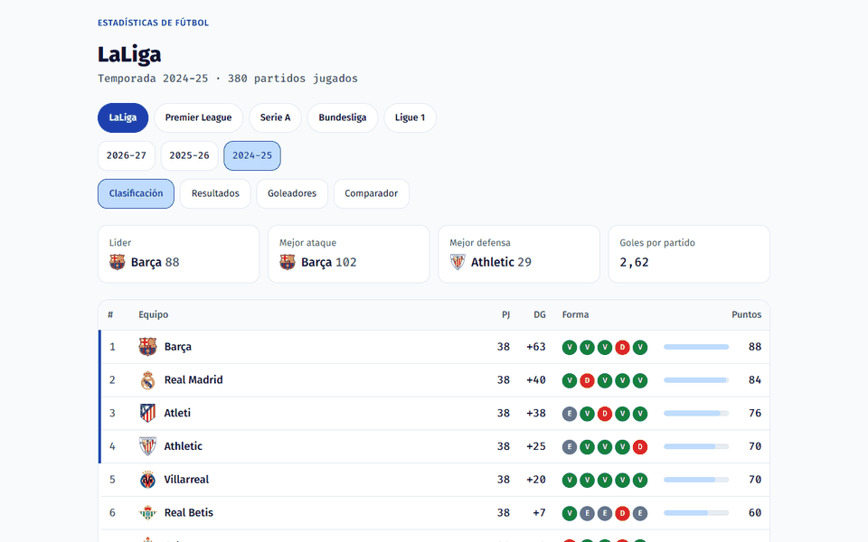

# Portfolio

I am a student building a portfolio of data and software projects for internship applications.
Each project lives in its own folder, runs locally and has its own README.

## Projects

| # | Project | Stack | Status |
|---|---|---|---|
| 1 | [Football stats dashboard](01-dashboard-deportes/) | Python, pandas, PostgreSQL, Next.js, TypeScript, GitHub Actions | Working. Five leagues, several seasons, match statistics. Next phases planned. |
| 2 | RAG study assistant | Local LLMs (Ollama), pgvector | Planned |

### 1. Football stats dashboard

Downloads real match data from public football sources, stores it in PostgreSQL, cleans it
with pandas and shows it in a Next.js web app: league tables, results by matchday, top
scorers, team pages with points charts and per-match stats, and a two-team comparator.
The web app is tested and checked on every push by GitHub Actions. It runs locally (no public
deployment); see the [project README](01-dashboard-deportes/README.md) for how to start it.

### 2. RAG study assistant

Planned: a study assistant that answers questions over my own notes, using local LLMs
through Ollama and a pgvector store. Nothing is built yet.
