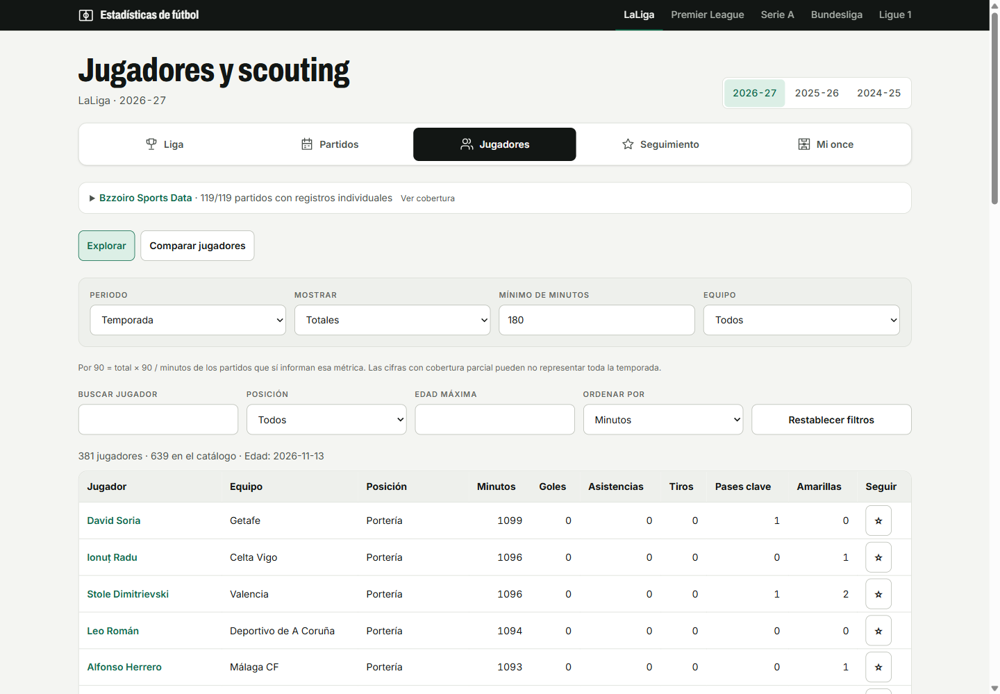
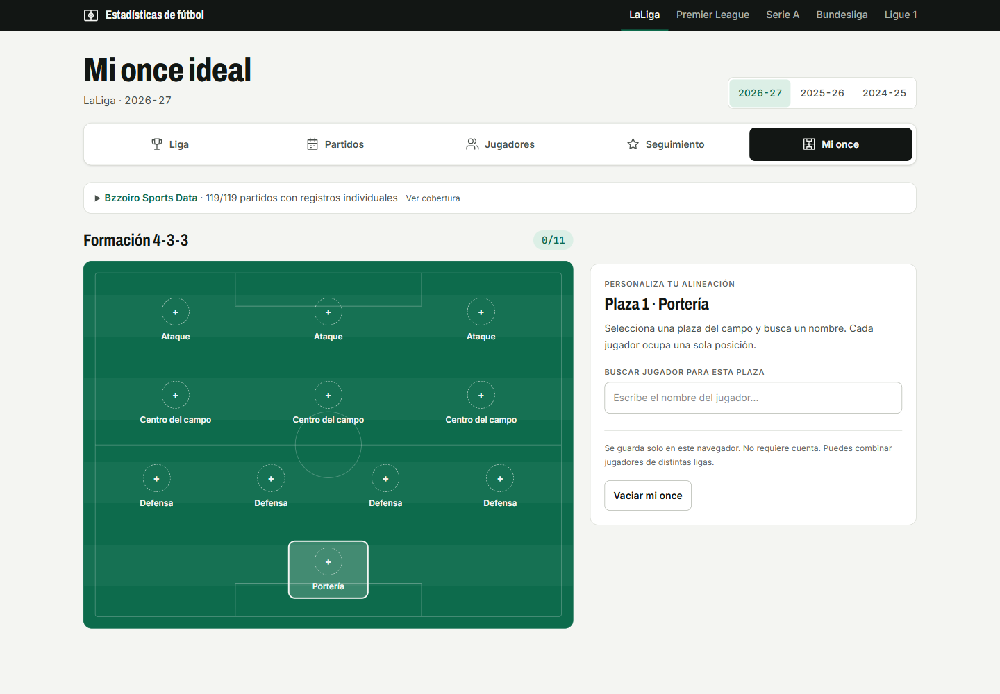
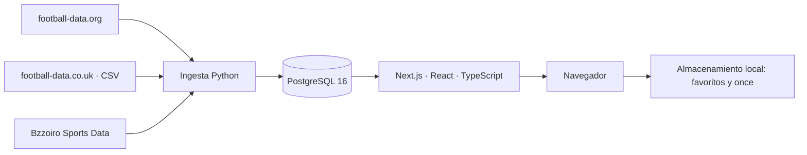

# Marcador · análisis de fútbol

[](https://github.com/liamanderson873/Dashboard-Deportes/actions/workflows/ci.yml)

Cinco grandes ligas europeas, estadísticas de equipos y jugadores, y un espacio personal para seguir favoritos y construir un once ideal. Una aplicación en español que transforma datos reales con **Python**, los almacena en **PostgreSQL** y los presenta con **Next.js**.

Proyecto personal de portfolio para prácticas. Se ejecuta en local; el repositorio contiene el código, las pruebas y las instrucciones para reproducirlo.


## Explora, compara y guarda

| Sección | Qué permite hacer |
|---|---|
| **Liga** | Clasificación, forma reciente, goleadores, fichas de equipos y comparación con enfrentamientos directos. |
| **Partidos** | Abrir primero el próximo encuentro, consultar resultados recientes o recorrer la temporada en orden cronológico. Cambiar a resultados por jornada. |
| **Jugadores** | Buscar y filtrar por equipo, posición, edad y minutos; comparar dos perfiles por nombre, con totales o cifras por 90. |
| **Seguimiento** | Guardar equipos y jugadores; reunir los próximos partidos de los equipos seguidos. |
| **Mi once** | Construir un 4-3-3 sobre un campo visual, con búsqueda por nombre, plazas por posición y sin jugadores repetidos. |

Las fichas individuales incluyen registro de partidos, evolución de goles y asistencias, percentiles y perfiles estadísticamente similares. El detalle de partido incorpora alineaciones, suplentes, eventos, estadísticas y mapas de tiros cuando el proveedor ofrece esos datos.

| Jugadores | Mi once ideal |
|---|---|
|  |  |

Los filtros de jugadores se pueden compartir por URL. Favoritos y alineación se guardan en el navegador, sin registro y sin sincronización entre dispositivos. La interfaz incluye navegación por teclado, controles con etiquetas, tablas alternativas a los gráficos y adaptación a móvil.

## Datos y temporada actual

**LaLiga, Premier League, Serie A, Bundesliga y Ligue 1.** El año de la ruta identifica el comienzo de la temporada: `/pd/2026` corresponde a **2026-27**. La clasificación y las vistas de equipos admiten también temporadas anteriores cargadas; la ampliación individual se ha verificado con 2026-27.

| Fuente | Uso |
|---|---|
| [football-data.org](https://www.football-data.org/) | Equipos, calendario, resultados, plantillas y goleadores. |
| [football-data.co.uk](https://www.football-data.co.uk/) | Estadísticas de partido importadas desde CSV. |
| [Bzzoiro Sports Data](https://sports.bzzoiro.com/) | Jugadores, actuaciones, alineaciones, eventos y tiros. |

Las claves de las APIs se configuran solo en Python. **La web consulta PostgreSQL y no consume peticiones de las APIs al navegar.** Los planes gratuitos tienen cuotas y condiciones propias; no se incluyen claves ni archivos externos de datos en el repositorio.

La carga de Bzzoiro del **13 de noviembre de 2026** reunió 1.752 encuentros, 500 terminados, 499 con registros individuales y 3.031 perfiles en las cinco ligas. Es una observación de esa importación, no una garantía de cobertura futura. Un encuentro de Premier League quedó sin estadísticas individuales y pendiente de reintento.

Los datos ausentes aparecen como **—**, nunca como ceros inventados. Las métricas por 90 utilizan únicamente los minutos de las actuaciones que informan esa métrica. Los percentiles y las similitudes explican su muestra y no constituyen predicciones. Consulta los [criterios de cálculo y límites de cobertura](docs/bsd-integration.md).

## Arquitectura



Las ingestas realizan actualizaciones idempotentes. Los datos de Bzzoiro viven en tablas `bsd_*`, con correspondencias explícitas de equipos entre proveedores; los IDs no se mezclan por similitud de nombres. Los componentes de servidor consultan la base y los componentes de cliente resuelven filtros e interacciones personales.

| Capa | Tecnologías |
|---|---|
| Datos | Python 3.12+, pandas, requests, SQLAlchemy, psycopg |
| Base de datos | PostgreSQL 16, Docker Compose |
| Interfaz | Next.js 16, React 19, TypeScript, Tailwind CSS 4 |
| Calidad | pytest, Vitest, ESLint, TypeScript y GitHub Actions |

## Arranque local

Necesitas **Python 3.12+**, **Node.js 24**, **Docker** y cuentas gratuitas en [football-data.org](https://www.football-data.org/client/register) y [Bzzoiro](https://sports.bzzoiro.com/register/) para importar los datos correspondientes.

Desde la raíz del repositorio, en PowerShell:

```powershell
cd 01-dashboard-deportes
python -m venv .venv
.venv/Scripts/python.exe -m pip install -r requirements.txt
.venv/Scripts/python.exe -m pip install -e .
Copy-Item .env.example .env
docker compose up -d
```

Edita `.env`: añade `FOOTBALL_API_KEY` y `BZZOIRO_API_KEY`. La configuración de ejemplo conecta a PostgreSQL en `127.0.0.1:5433`. No subas `.env` a Git.

```powershell
# Datos base de las cinco ligas, temporada 2026-27
.venv/Scripts/python.exe -m sports_dashboard.ingest --competitions PD,PL,SA,BL1,FL1 --seasons 2026
# Ampliación de jugadores y partidos; puede tardar en la primera carga
.venv/Scripts/python.exe -m sports_dashboard.bsd --competitions PD PL SA BL1 FL1 --season 2026
.venv/Scripts/python.exe -m sports_dashboard.bsd --mapping-file data/bsd_team_map.json

cd web
Copy-Item .env.example .env.local
npm ci
npm run dev
```

Abre [localhost:3000](http://localhost:3000). En Linux/macOS usa `.venv/bin/python` y `cp` en lugar de los comandos equivalentes de Windows. Los CSV de estadísticas de equipo son una ampliación opcional: sigue la [guía técnica de importación](01-dashboard-deportes/README.md).

Para actualizar los datos, vuelve a ejecutar las ingestas. **No hay actualización automática ni servicio en directo.** Si Bzzoiro termina con código `2`, revisa los partidos pendientes que informa: los demás datos importados se conservan. La [guía de Bzzoiro](docs/bsd-integration.md) describe límites de peticiones, reintentos y correspondencias.

## Validación

```powershell
# Desde 01-dashboard-deportes
.venv/Scripts/python.exe -m pytest -q
# Después, desde 01-dashboard-deportes/web
npm test
npm run lint
npm run typecheck
npm run build
```

Las pruebas de integración requieren PostgreSQL y utilizan exclusivamente **sports_test**. No ejecutes simultáneamente las suites de Python y web contra esa misma base. GitHub Actions ejecuta ambos trabajos con bases independientes. La verificación local de esta versión incluye **111 pruebas Python y 165 pruebas web**, además de lint, tipos y compilación.

## Estructura y documentación

```text
01-dashboard-deportes/
  src/sports_dashboard/    Clientes, transformación e ingestas
  sql/schema.sql          Esquema PostgreSQL y tablas bsd_*
  data/bsd_team_map.json   Correspondencias verificadas de equipos
  tests/                  Pruebas de Python
  web/src/app/            Rutas por liga y temporada
  web/src/components/     Interfaz, gráficos y espacios personales
  web/src/lib/             Consultas y cálculos estadísticos
docs/                     Guías y decisiones del proyecto
```

- [Detalles de datos e ingesta](01-dashboard-deportes/README.md).
- [Rutas y desarrollo de la web](01-dashboard-deportes/web/README.md).
- [Jugadores: configuración, fórmulas y limitaciones](docs/bsd-integration.md).
- [Guía explicada del proyecto](docs/guia-explicada.md).
- [Criterios de interfaz](docs/diseno-marcador.md).

El siguiente paso es ampliar la validación de cobertura y facilitar las actualizaciones de datos. El uso de cada fuente está sujeto a sus condiciones; revisa las de [Bzzoiro](https://sports.bzzoiro.com/docs/api-license/) y las condiciones de uso particular de los CSV antes de reutilizar los datos.
