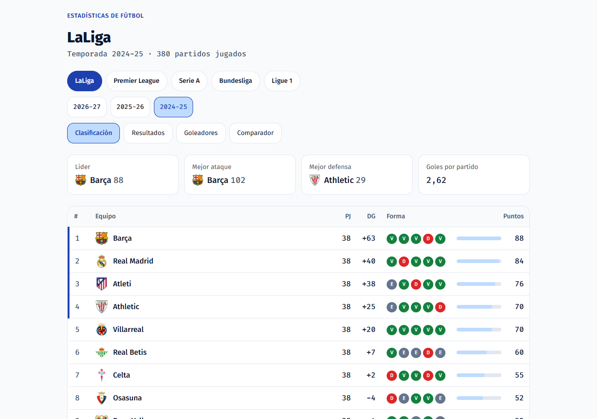
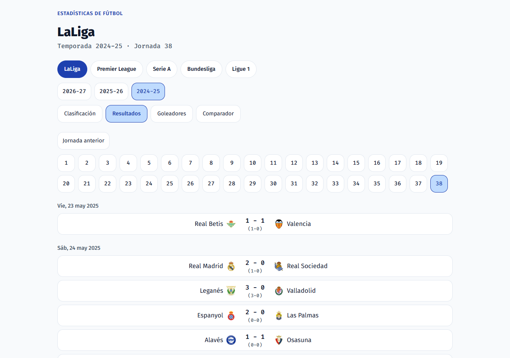
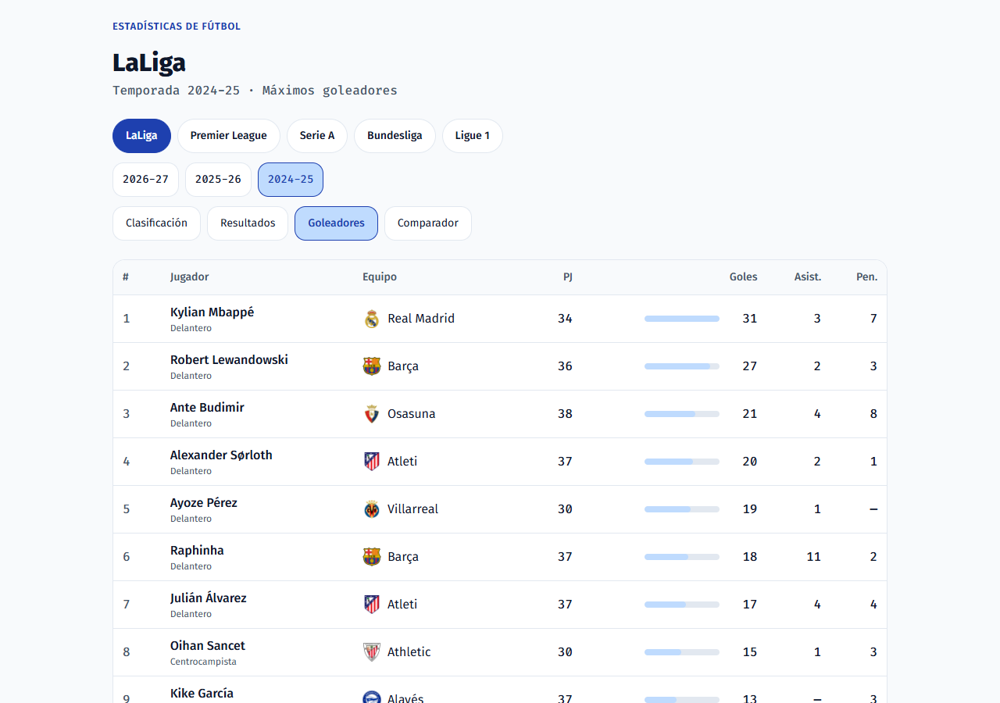
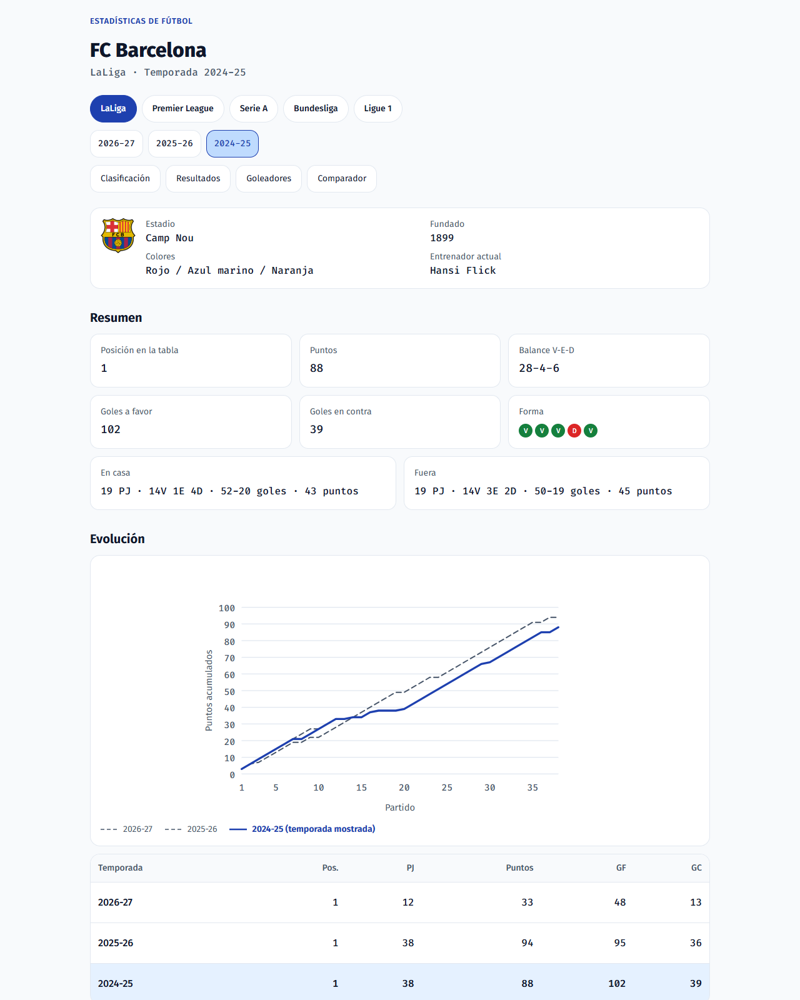
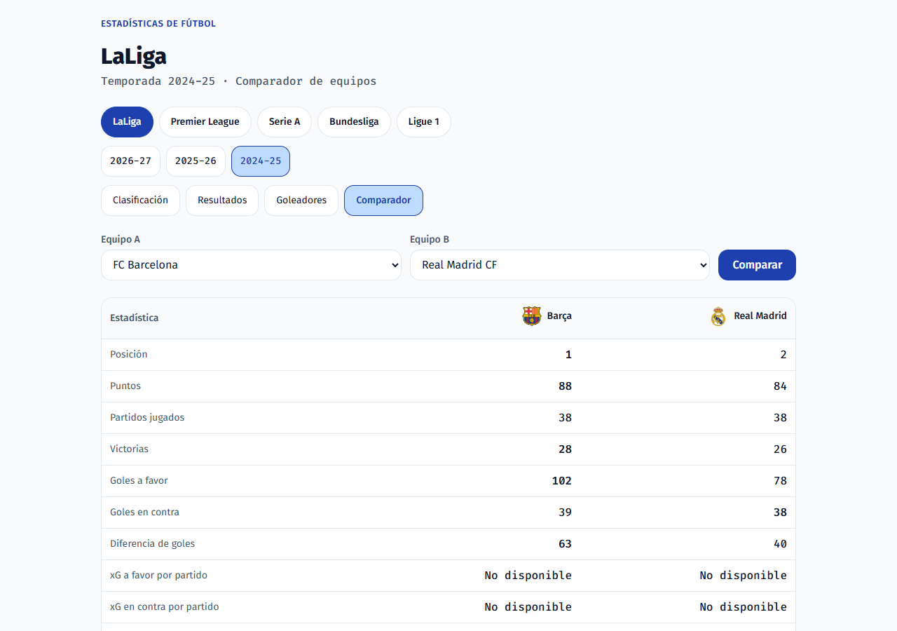
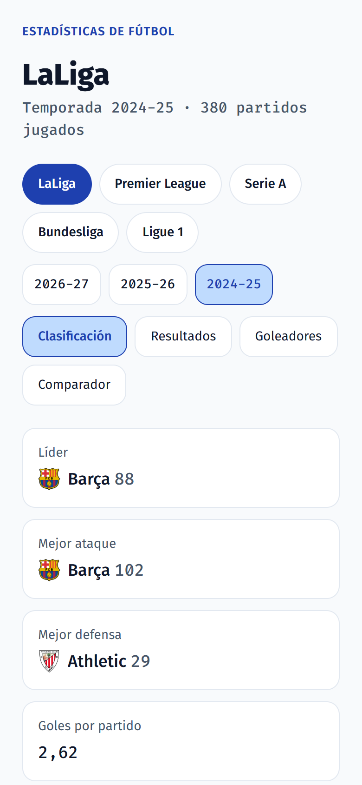

# Dashboard de estadísticas de fútbol

Aplicación que descarga datos reales de fútbol de fuentes públicas y gratuitas, los limpia
con Python, los guarda en PostgreSQL y los muestra en una web en español hecha con Next.js.
Cubre las cinco grandes ligas europeas (LaLiga, Premier League, Serie A, Bundesliga y
Ligue 1) en las temporadas 2024-25, 2025-26 y 2026-27.

Es un proyecto de portfolio para prácticas: funciona en local (no hay despliegue público) y
está probado con tests automáticos que GitHub ejecuta en cada cambio.


## Qué se puede ver

| Clasificación | Resultados por jornada |
|---|---|
|  |  |
| **Goleadores** | **Ficha de equipo** |
|  |  |
| **Comparador de equipos** | **Versión móvil** |
|  |  |

- **Clasificación**: tarjetas de resumen (líder, mejor ataque, mejor defensa, goles por
  partido), tabla con zonas, forma de los últimos 5 partidos y barra de puntos.
- **Resultados por jornada**, con el marcador del descanso y el estado de los partidos
  pendientes.
- **Goleadores**: los 50 primeros, con asistencias y penaltis.
- **Ficha de equipo**: datos del club, balance en casa y fuera, gráfico de evolución de
  puntos por temporada, estadísticas por partido (xG, tiros, córners, faltas, tarjetas),
  plantilla de la temporada y partidos.
- **Comparador** de dos equipos con los enfrentamientos directos.
- Adaptada al móvil y accesible (contraste, navegación con teclado, tablas como alternativa
  a los gráficos).

## Cómo funciona

```
football-data.org (API)        --\
                                  >  Python (pandas)  ->  PostgreSQL  ->  Web Next.js
football-data.co.uk (CSV)      --/
```

1. **Ingesta en Python** (`01-dashboard-deportes/src/sports_dashboard`): descarga partidos,
   equipos, plantillas y goleadores de la API de football-data.org respetando su límite de
   peticiones, importa las estadísticas por partido de los CSV de football-data.co.uk y lo
   guarda todo en PostgreSQL. Se puede ejecutar varias veces sin duplicar datos.
2. **PostgreSQL en Docker**: la base de datos se levanta con un solo comando.
3. **Web en Next.js** (`01-dashboard-deportes/web`): lee directamente de la base de datos con
   componentes de servidor; nunca llama a la API, así que los límites del plan gratuito no
   pueden romperla. Los gráficos son SVG generados en el servidor.

## Tecnologías

| Parte | Herramientas |
|---|---|
| Datos | Python, pandas, requests, SQLAlchemy |
| Base de datos | PostgreSQL 16 en Docker |
| Web | Next.js, React, TypeScript, Tailwind CSS, postgres.js |
| Pruebas | pytest (100 tests), Vitest (134 tests) con una base de datos de prueba |
| CI | GitHub Actions: un trabajo para Python y otro para la web (lint, tipos, tests y build) |

## Arrancarlo en local

Necesitas Python 3.12+, Node.js 24, Docker y una clave gratuita de
[football-data.org](https://www.football-data.org/client/register).

```bash
cd 01-dashboard-deportes
python -m venv .venv
.venv\Scripts\activate              # Linux/macOS: source .venv/bin/activate
pip install -r requirements.txt
pip install -e .
cp .env.example .env                # pon tu clave en FOOTBALL_API_KEY
docker compose up -d                # PostgreSQL en localhost:5433
python -m sports_dashboard.ingest --competitions PD --seasons 2024

cd web
cp .env.example .env.local
npm install
npm run dev                         # http://localhost:3000
```

Los detalles (carga de varias ligas, estadísticas de los CSV, tests y limitaciones de los
datos) están en el [README del proyecto](01-dashboard-deportes/README.md) y en el de la
[web](01-dashboard-deportes/web/README.md). Hay además una
[guía explicada para principiantes](docs/guia-explicada.md) de cada herramienta usada.

## Próximos pasos

- Estadísticas avanzadas de jugadores con API-Football.
- Análisis histórico con los datos abiertos de StatsBomb (mapas de tiros).
- Predicción de resultados con scikit-learn, comparada con la regla "gana el de casa".

## Fuentes de datos

- [football-data.org](https://www.football-data.org/), plan gratuito.
- [football-data.co.uk](https://www.football-data.co.uk/): estadísticas por partido. Sus
  condiciones permiten el uso particular, no comercial; los CSV no se suben al repositorio.
