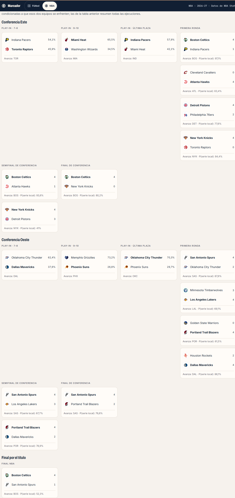
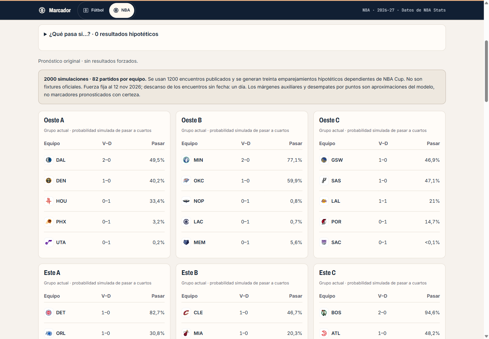
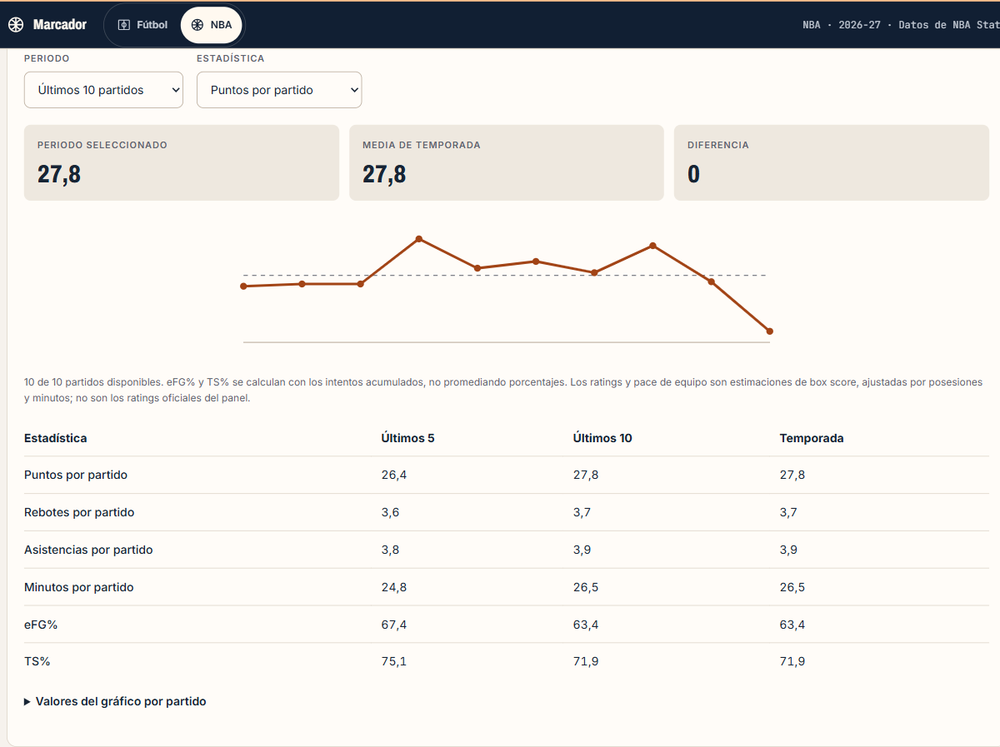
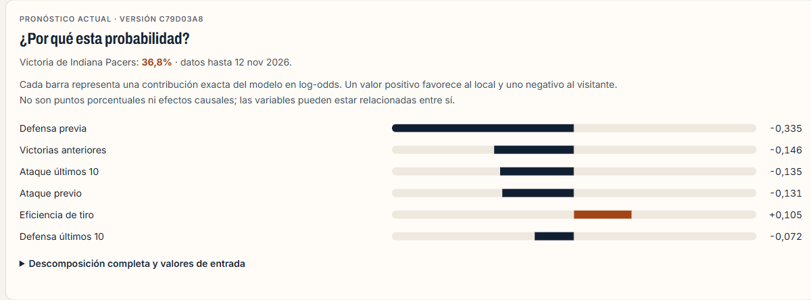

# Laboratorio NBA · simulación, escenarios y evaluación prospectiva

## Uso

Abre `/nba/2026/modelos`, ahora **Simulador NBA**. Sus herramientas son Playoffs, NBA Cup e Historial. Puedes seguir un equipo, filtrar conferencia, inspeccionar un recorrido y abrir las fichas desde cada cruce. Las fichas de equipo y jugador comparan últimos cinco/diez partidos con la temporada; el mapa de tiro filtra periodo y zonas y muestra acierto real y esperado.

En **¿Qué pasa si…?**, selecciona un partido pendiente, un ganador hipotético y pulsa Añadir condición. Puedes reunir hasta doce condiciones. Recalcular actualiza las tablas y los cuadros; Restaurar devuelve el pronóstico original. Los escenarios no modifican resultados, modelos guardados ni el historial. Las diferencias pequeñas pueden deberse al ruido Monte Carlo.

## Reproducción

Desde `01-dashboard-deportes`, con PostgreSQL, el entorno virtual, la ingesta y el modelo logístico existentes:

```powershell
.venv/Scripts/python.exe -m sports_dashboard.nba.lab --season 2026
```

La orden publica los insumos del laboratorio en PostgreSQL y añade pronósticos futuros al historial. El entrenamiento completo `python -m sports_dashboard.nba.train --season 2026 --history 10 --shot-history 3 --runs 10000` también ejecuta esta publicación al finalizar. Los binarios propios de modelos se leen solo en el proceso offline; ninguna petición web deserializa un modelo ni inicia Python. No se necesitan nuevas claves de API.

La configuración incluye matrices del modelo, evaluaciones, corte, versiones de bibliotecas y SHA-256 del publicador y motor. La huella del contenido identifica la versión. Se excluye la hora de emisión del cálculo de esa huella. La web recupera la configuración solo en la ruta de simulación; no la envía en las páginas ordinarias de NBA.

## Calendario y NBA Cup

La configuración 2026 verifica seis grupos y sesenta encuentros del archivo contra los participantes y las fechas de Copa, con cuatro partidos por equipo y sin parejas duplicadas. Se conservan resultados observados. Referencias de reglas y grupos: [NBA Cup 2026](https://www.nba.com/news/nba-cup-101); referencias de desempates: [clasificación NBA](https://www.nba.com/standings?Season=2026-27).

Dentro de cada ejecución se resuelven grupos, comodines y eliminatorias. Los seis partidos de cuartos/semifinales cuentan para la temporada; la final de Copa se mantiene aparte. Los cuatro perdedores de cuartos juegan dos encuentros complementarios entre ellos, uno por conferencia. Los otros veintidós equipos reciben dos emparejamientos mediante una rotación reproducible que evita repetir pareja en esas dos rondas. Es una política hipotética de asignación, no una reproducción de decisiones futuras de la NBA.

Cada ejecución comprueba treinta encuentros añadidos, 1.230 victorias totales y 82 partidos por equipo. No se insertan en `nba_games`. La versión actual requiere un calendario base de ochenta encuentros por equipo: si cambia su estructura, el motor falla con un mensaje explicativo en vez de completar incorrectamente los huecos. Los grupos de otra temporada requieren una configuración verificada nueva.

## Simulación y límites

Se ejecutan 2.000 recorridos, semilla 42. La regresión logística histórica sigue definiendo las probabilidades de victoria; la fuerza del equipo permanece fija al último corte. Los partidos publicados utilizan su descanso previsto. Para emparejamientos sin fecha y postemporada se supone un día libre. Las localías de Copa siguen la clasificación del torneo y su final usa una matriz neutral simétrica. Las series de playoffs respetan el patrón de localía 2-2-1-1-1.

Los cuadros muestran el primer recorrido de esa semilla, con sus participantes y ganadores coherentes entre rondas. La probabilidad de un cruce es condicional a que se produzca; las tablas agregan todos los recorridos. No se simulan lesiones ni traspasos futuros. Los intervalos de victorias recogen variación de resultados y cruces con el modelo fijo, no toda la incertidumbre del modelo.

Para desempates se utiliza una regresión Ridge de margen (`alpha=100`, imputador y escalador), ajustada a las características previas de diez temporadas. La prueba 2025-26 se evalúa antes del reajuste de producción. MAE: 11,5899 puntos; referencia constante: 13,2529; RMSE: 14,7637, sobre 1.236 encuentros. Los márgenes se muestrean condicionados al ganador logístico; los puntos totales utilizan una distribución auxiliar y se modela una frecuencia histórica de prórroga. No debe interpretarse esa capa como un modelo de marcadores exactos ni su evaluación como validación completa de desempates o de intervalos de temporada.

La clasificación considera récord, división, enfrentamientos directos, conferencia, rivales elegibles y diferencia de puntos, con reinicio de criterios tras una separación parcial. Los empates persistentes se sortean. En Copa se anula el diferencial de partidos con prórroga. Si un encuentro observado con prórroga carece de parciales, sus puntos anotados de desempate son aproximados; la interfaz informa del número de casos afectados. Los encuentros simulados con prórroga conservan por separado sus puntos de regulación.

## Historial que se puede auditar

`nba_prediction_history` añade una fila por temporada, partido, versión y día de pronóstico. Una publicación repetida no sobrescribe esa fila; las ingestas no borran el historial. Se guardan fecha de emisión, fecha de datos, probabilidad y contribuciones del modelo.

Sin horas de inicio fiables, se acepta un pronóstico únicamente cuando se emite en una fecha de Nueva York anterior al partido y el corte de datos también es anterior. La web vuelve a verificar esas condiciones y utiliza la última versión válida de cada encuentro. No admite pronósticos del mismo día ni reconstruye predicciones aparentes después del resultado. Los encuentros pendientes no cuentan para Brier, log loss ni fiabilidad observada. Una muestra sin resultados válidos muestra un estado vacío, no ceros ni porcentajes ficticios.

El registro empieza con esta entrega. La prueba temporal histórica sigue visible, pero se distingue de los resultados prospectivos que se acumulen a partir de ahora. Se muestra emisión, corte y versión por fila, con filtros y carga progresiva. Las explicaciones de encuentros ya resueltos se recuperan de su pronóstico previo guardado.

## Explicaciones y tendencias

El pronóstico descompone el logit en intercepto y trece contribuciones exactas del modelo ajustado. Su suma reproduce `P = 1 / (1 + exp(−suma))`. Las barras no representan puntos porcentuales ni causas: algunas variables están correlacionadas. La tabla completa conserva el valor de entrada y su contribución.

Las tendencias utilizan los registros disponibles. eFG% y TS% se ponderan por intentos acumulados. OffRtg, DefRtg y pace de tendencia son estimaciones de posesiones obtenidas de ambos box scores; no se confunden con los ratings oficiales de temporada. Las zonas de tiro son geométricas propias; se conservan aciertos y fallos, límites de muestra y datos ausentes. Una diferencia entre acierto real y esperado con pocos intentos no demuestra una habilidad estable.

## Validación

Pruebas de identidad de la descomposición logística, registro previo inmutable, exclusión de emisiones tardías, conservación del calendario, suma de probabilidades y clasificados, escenarios, series, desempates parciales, porcentajes ponderados, zonas, payloads y límites de petición. Las bases de pruebas son exclusivamente `sports_test`; fútbol y sus datos personales permanecen separados.

## Capturas de la implementación

| Cuadro de un recorrido | Grupos de NBA Cup |
|---|---|
|  |  |
| **Forma reciente** | **Contribuciones del modelo** |
|  |  |
