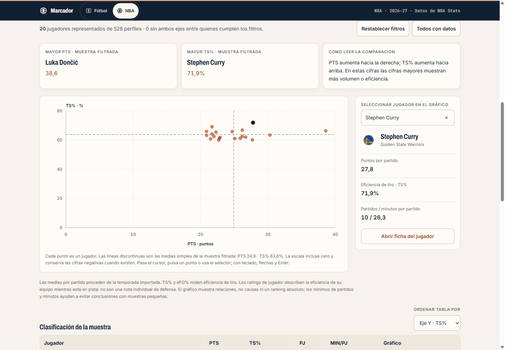
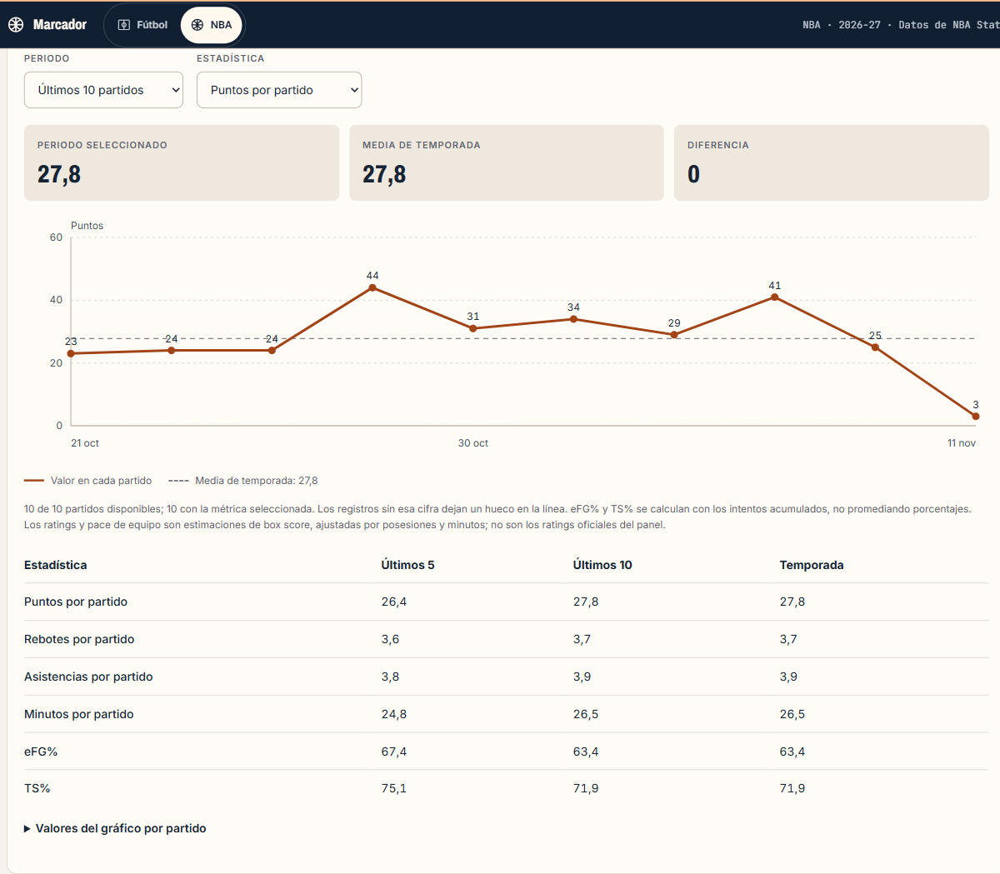
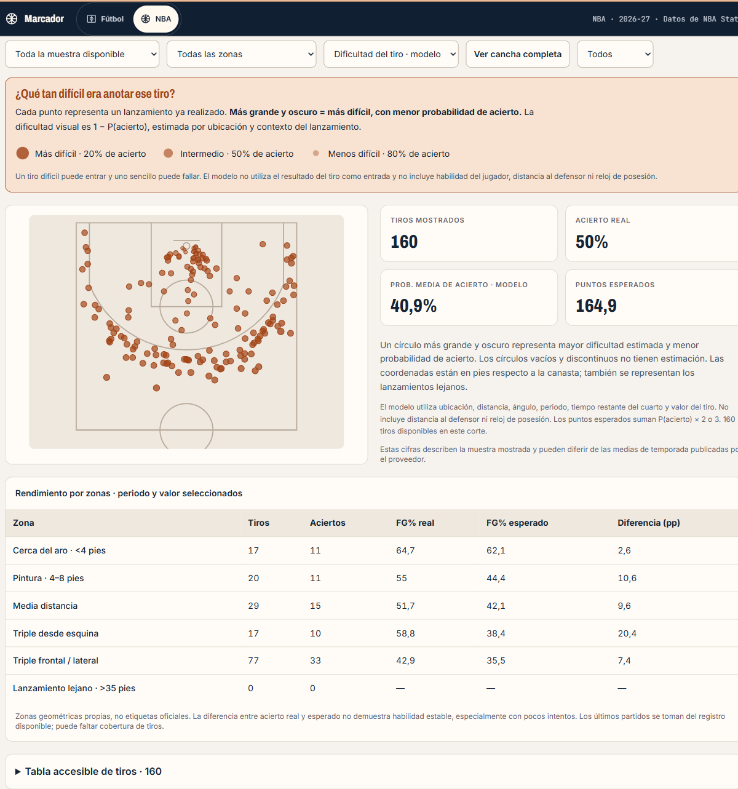

# Lectura y comparación visual de estadísticas NBA

## Mapa de jugadores

Ruta: `/nba/2026/jugadores?tab=chart`. Dentro de **Jugadores** aparece junto a Explorar y Comparar jugadores. Cada punto representa un jugador con cifras conocidas en ambos ejes.

- Dos selectores independientes con 21 estadísticas: puntos, rebotes, asistencias, robos, tapones, pérdidas, minutos, partidos, porcentajes de tiro y métricas avanzadas.
- Comparativas preparadas de anotación/eficiencia, asistencias/pérdidas, uso/eficiencia y minutos/rebotes.
- Filtros de equipo y posición; por defecto, al menos cinco partidos y quince minutos por partido. **Todos con datos** elimina esos mínimos y las condiciones.
- Hasta seis condiciones simultáneas, sobre cualquier métrica disponible: por ejemplo PTS ≥ 20 y TS% ≥ 60. Los porcentajes se introducen en unidades de 0 a 100. Los campos ausentes no se sustituyen por cero.
- Ejes con marcas numéricas y unidades. La escala incluye cero por defecto, conservando ratings negativos; se puede ajustar a la muestra con una indicación explícita.
- Las líneas discontinuas indican medias simples de los jugadores filtrados, no la media de liga ponderada por intentos o minutos.
- Una tabla ordenable presenta los valores exactos y permite destacar jugadores. En pérdidas y rating defensivo se ordenan primero las cifras menores; los indicadores se refieren siempre a la muestra filtrada.
- Búsqueda por nombre para seleccionar un punto, selección con ratón o toque y recorrido por teclado mediante flechas y Enter. Los enlaces abren la ficha de cada jugador.
- Los ejes, filtros, condiciones y selección se reflejan en la URL. La vista conserva su estado al alternar las pestañas durante la sesión. El gráfico se monta al abrir su pestaña para evitar enviar su marcado en la vista de exploración normal.

El tamaño de la muestra condiciona la interpretación. TS% combina la puntuación y los intentos de campo y libres; puede superar el 100% en muestras pequeñas. Los ratings de jugador describen la eficiencia de su equipo en pista. Una posición favorable en un gráfico de dos variables no constituye un ranking absoluto ni demuestra causalidad.

## Forma reciente con escala

Las fichas de jugadores y equipos tienen un eje vertical que comienza en cero (e incluye valores negativos si existen), con marcas redondeadas automáticamente y unidades. El eje horizontal muestra fechas. Se conservan la línea de media de temporada y la tabla alternativa; los puntos llevan valores cuando hay espacio suficiente.

La anchura real del panel determina las coordenadas SVG para mantener legibles las etiquetas también en móvil. Los registros sin la métrica seleccionada dejan huecos en la línea; nunca se dibujan como ceros.

## Dificultad estimada del tiro

En **Representación**, selecciona **Dificultad del tiro · modelo**. Un panel explicativo y una leyenda distinguen esta vista de Aciertos y fallos:

- Mayor tamaño y oscuridad significan mayor dificultad y menor probabilidad estimada de acierto.
- La escala visual utiliza `1 − P(acierto)`, una lectura inversa de la probabilidad existente; no se ha entrenado un modelo diferente ni modificado sus probabilidades.
- Ejemplos de leyenda: 20%, 50% y 80% de acierto, de mayor a menor dificultad. Los tiros sin estimación tienen un círculo vacío discontinuo.
- Un tiro difícil puede entrar y uno sencillo fallar. La tabla conserva el resultado real y la probabilidad exacta.

Se mantienen las limitaciones: ubicación y contexto confirmado, sin habilidad individual del tirador, distancia al defensor ni reloj de posesión. Los datos llegan de importaciones; el mensaje de mapa vacío lo explica.

## Corrección de unidades en los agregados

Durante la validación del filtro de minutos se detectó que la combinación de tablas Base, Advanced, Usage y Scoring sobrescribía cifras por partido con totales: por ejemplo, Usage contenía 263 minutos para Curry, mientras Base informaba 26,3 por partido. También podían sobrescribirse FGM/FGA.

La normalización ahora toma los campos convencionales por partido exclusivamente de Base, antes de incorporar las cifras avanzadas. Si Base no informa de una cifra, no se sustituye por un total de otra tabla. Los ceros conocidos se conservan y la combinación es independiente del orden de esas tablas.

Para una instalación que ya tenga datos importados, desde `01-dashboard-deportes`:

```powershell
.venv/Scripts/python.exe -m sports_dashboard.nba.ingest --season 2026 --display-stats-only
```

Esta reparación exige que los archivos tengan exactamente los SHA-256 ya registrados en `nba_sources`; rechaza una instantánea nueva para evitar mezclar datos. Actualiza únicamente métricas de perfiles y equipos existentes y anota la versión de normalización. Conserva jugadores de plantilla sin agregados, partidos, tiros, modelos, historial y datos de fútbol. Las ingestas completas posteriores ya utilizan la normalización corregida.

En la instalación revisada se repararon 464 agregados oficiales de jugadores y 30 de equipos. Los otros perfiles conservan sus datos previos y marcas de ausencia. Las probabilidades entrenadas no utilizan esas tablas de presentación y permanecen sin cambios.

## Verificación

### Capturas







Pruebas de escalas, valores negativos, datos vacíos, inversión visual de dificultad, conversión de porcentajes, filtros simultáneos, orden de métricas y condiciones compartibles. Pruebas de regresión para los campos Base, conservación de modelos/historial y rechazo atómico de archivos con otra firma. Revisión de navegador con selección por teclado, PTS ≥ 20 junto con TS% ≥ 60, recarga de URL y anchos móvil, tablet y escritorio.
